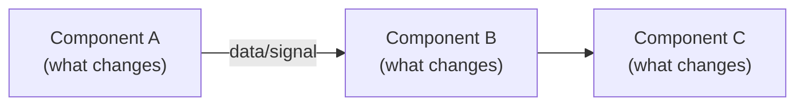

# Research PRs

Learn how to accomplish a task by studying GitHub PRs, then deep-dive into local code to produce an actionable implementation plan.

Codex users invoke this skill as `$research-prs`; existing Claude/Cursor slash-command invocations remain supported.

## Prerequisites

- **GitHub CLI (`gh`)** must be installed and authenticated (`gh auth login`).
  Install: `brew install gh` (macOS) or see https://cli.github.com

## Minimizing Permission Prompts

All `gh` commands require network access. Use the active agent's normal approval or escalation mechanism when required.

Batch all `gh` commands into a **single chained shell command** that saves results to a temporary directory. The user approves once for the entire batch, then the agent reads the output files locally (no further prompts).

Pattern:
```bash
mkdir -p /tmp/research-prs-<TOPIC>-<RANDOM> && \
gh search prs ... > /tmp/research-prs-<TOPIC>-<RANDOM>/search.txt && \
gh pr view ... > /tmp/research-prs-<TOPIC>-<RANDOM>/repo-name-123-view.txt && \
gh pr diff ... > /tmp/research-prs-<TOPIC>-<RANDOM>/repo-name-123-diff.txt && \
echo "Done"
```

After the command runs, use the Read tool to read the output files - no permission needed.

## Input Modes

This skill accepts two types of input:

### Mode A: Username(s) + task
Example: `/research_prs check @example-user's PRs and learn how to add feature logging for ads`
Example with multiple users: `/research_prs check @example-user and @example-user's PRs and learn how to add feature logging`
- Extracts one or more **authors**, **task/keywords**, and optional **date range** or **repo/org filter**
- If no date range is specified, ask: "How far back should I search? (e.g., last 3 months, last year, all time)"

### Mode B: Direct PR links
Example: `/research_prs learn from these PRs how to add feature logging: https://github.com/org/repo/pull/123, https://github.com/org/repo/pull/456`
- Parse PR URLs directly
- Skip search - go straight to Phase 3

### Mode C: Username(s) + direct PR links (combined)
Example: `/research_prs check @example-user's PRs and also these PRs https://github.com/org/repo/pull/123, https://github.com/org/other/pull/456 to learn how to add feature logging`
- Extracts **both** author(s) **and** PR URLs from the input
- Runs the Mode A search flow (Phase 2) to discover additional relevant PRs
- The directly provided PRs are **always included** in the analysis - they bypass the search and confirmation steps
- During Phase 2 confirmation, present the search results alongside the pre-selected direct PRs (marked as "provided directly") so the user sees the full set
- Proceed to Phase 3 with the union of confirmed search results and the direct PRs

---

## Workflow

### Phase 1: Parse request and determine mode

- If input contains **both** GitHub PR URLs (matching `github.com/.+/pull/\d+`) **and** one or more usernames -> **Mode C**
- If input contains GitHub PR URLs but no usernames -> **Mode B**
- If input contains one or more usernames but no PR URLs -> **Mode A**
- Extract the **task description** (what the user wants to learn how to do)

### Phase 2: Search and confirm PRs (Mode A and Mode C)

If no date range was provided, ask the user for one before searching.

Pull **all PRs by each author** within the date range - do NOT add task keywords to the search query. The agent will judge relevance from the titles and descriptions afterward.

By default, search only **merged** PRs. If the user explicitly asks to include unmerged/open PRs, respect that and drop the `--merged` flag.

Default limit is **300** PRs per author. The user can override this (e.g., "limit 50"). Use `--limit` accordingly.

Run the search as a single chained command saving to `/tmp/`. For multiple authors, chain all searches together:

```bash
mkdir -p /tmp/research-prs-<RANDOM> && \
gh search prs --author=<USER1> --merged --merged-at=">YYYY-MM-DD" --sort=updated --limit=300 \
  > /tmp/research-prs-<RANDOM>/search-<USER1>.txt && \
gh search prs --author=<USER2> --merged --merged-at=">YYYY-MM-DD" --sort=updated --limit=300 \
  > /tmp/research-prs-<RANDOM>/search-<USER2>.txt && \
echo "Done"
```

Adjust the search flags as needed:
- Add `--repo=<ORG/REPO>` to scope to a specific repo
- Drop `--merged` if the user asks to include unmerged PRs

Read all search result files. Deduplicate across authors (same PR may appear for co-authors).

Read the search results file, review PR titles, and select candidates that appear relevant. For those candidates, batch-fetch descriptions in a single chained command:

```bash
gh pr view <N1> --repo=<ORG/REPO1> --json title,body,url --jq '{title,body,url}' \
  > /tmp/research-prs-<RANDOM>/desc-<REPO1>-<N1>.txt && \
gh pr view <N2> --repo=<ORG/REPO2> --json title,body,url --jq '{title,body,url}' \
  > /tmp/research-prs-<RANDOM>/desc-<REPO2>-<N2>.txt && \
echo "Done"
```

Read the description files. Use both title and description to make the final relevance judgment.

**Present the relevant PRs to the user** as a numbered list with title, repo, date, and **clickable URL**. Ask the user to confirm which PRs to analyze before continuing. Proceed only with the confirmed set.

**Mode C note**: When presenting the list, include the directly provided PRs at the top, marked as **(provided directly - always included)**. The user can deselect search results but the direct PRs remain in the set unless the user explicitly removes them. Deduplicate: if a search result matches a directly provided PR, don't list it twice.

### Phase 3: Extract PR content

Once the user confirms the set of PRs, fetch **all** PR details and diffs in a single chained shell command. This requires only **one permission prompt** for the entire batch.

```bash
# Single chained command - one permission prompt for everything
gh pr view <N1> --repo=<ORG/REPO1> > /tmp/research-prs-<RANDOM>/view-<REPO1>-<N1>.txt && \
gh pr view <N2> --repo=<ORG/REPO2> > /tmp/research-prs-<RANDOM>/view-<REPO2>-<N2>.txt && \
gh pr diff <N1> --repo=<ORG/REPO1> > /tmp/research-prs-<RANDOM>/diff-<REPO1>-<N1>.txt && \
gh pr diff <N2> --repo=<ORG/REPO2> > /tmp/research-prs-<RANDOM>/diff-<REPO2>-<N2>.txt && \
echo "Done"
```

Then read each output file using the Read tool (no further prompts needed).

For very large diffs (>2000 lines in the output file), list changed files first and focus on the most relevant:

```bash
gh pr view <NUMBER> --repo=<ORG/REPO> --json files --jq '.files[].path'
```

#### Filtering out noise in large PRs

- **Auto-generated files**: Skip files that contain headers like `// Code generated`, `# Auto-generated`, `DO NOT EDIT`, or similar markers. If a single file has thousands of changed lines, it is very likely auto-generated - skip it.
- **Prioritize real code over tests**: Focus on production code changes (service logic, proto definitions, configs, pipelines) first. Only read test files if they are needed to understand how a function/API is used or how things work.
- **Lock files and vendor dirs**: Skip `go.sum`, `yarn.lock`, `uv.lock`, `vendor/`, etc.

From each PR, extract:
- **Files changed** and their purpose (proto, config, service code, pipeline, etc.)
- **Repos involved**
- **Patterns followed** (naming conventions, file organization, config structure)
- **End-to-end flow** across the changes

#### Identify domain experts

While reading PR diffs, note the PR author and reviewers. During Phase 4, use `git blame` on key files to identify who has been most active in the relevant areas. Present a short list of **domain experts** the user may want to consult:

```bash
git blame --line-porcelain <FILE> | grep "^author " | sort | uniq -c | sort -rn | head -5
```

#### PRs are leads, not the full picture

The PR search provides **starting leads**, not a complete answer. PRs may be missing from the search results, and the original PRs may not cover all the changes needed. The agent must go beyond the PRs:

- Use `git log --all --oneline -- <FILE>` on key files to find **other related commits** not in the search results
- Use `git log --all --oneline --grep="<KEYWORD>"` to find commits by other authors that touched the same area
- Follow references in PR descriptions or code comments to discover additional repos or components
- Use Grep and SemanticSearch in local repos to trace the full flow

The goal is to build a **complete** implementation plan, not just replicate what was in the PRs.

### Phase 4: Verify against local repos (mandatory)

This phase is **mandatory**. The agent must verify the proposed plan works end-to-end against the actual codebase before presenting it.

1. **Locate repos**: Derive the base path from the current workspace location (e.g., if the workspace is `[local path removed]`, the base path is likely `[local path removed]`). Check if the repos identified from the PRs exist as sibling directories:
   ```bash
   ls <WORKSPACE_PARENT>/<REPO_NAME> 2>/dev/null
   ```
   If **all** repos are found, proceed without asking. If any are **missing**, ask the user where their repos are hosted locally (e.g., `~/repo`). If a repo still can't be found, offer to clone it (`git clone <REPO_URL> <BASE_PATH>/<REPO_NAME>`) and wait for explicit permission.

2. **Fetch latest and check branch state**: For each repo, fetch the latest from origin and check the current branch:
   ```bash
   cd <BASE_PATH>/<REPO_NAME> && git fetch origin && git branch --show-current && git status --short
   ```
   - If the repo is **not on main/master**, ask the user: "This repo is on branch `<branch>`. Would you like to switch to `main`/`master` to verify against the latest code?"
   - If there are **uncommitted changes** and the user wants to switch, ask: "There are uncommitted changes. Would you like to stash them before switching? (I can run `git stash` and restore them later.)"
   - If the user declines to switch, proceed with the current branch - but note in the plan that verification was done against a non-default branch.
   - After switching (or staying), pull latest: `git pull origin <BRANCH>` to ensure the local branch is up to date.

3. **Read current file state**: The files from the PRs may have changed since the PRs were merged. Read their current versions to confirm patterns still hold and identify any drift.

5. **Search for related code**: Use Grep and SemanticSearch to find:
   - Other callers or consumers of functions/protos modified in the PRs
   - Related config entries or feature flags
   - Similar patterns elsewhere in the codebase that should be replicated

6. **Trace the end-to-end flow**: Follow the data/control flow across repos, e.g.:
   - Proto definitions -> service code -> config -> pipeline code -> training data

7. **Identify additional changes**: Find files that would need modification but were NOT in the original PRs (e.g., a new config entry requires a corresponding proto field, or a new feature needs a training pipeline update).

8. **Validate the plan**: Before presenting, confirm that:
   - All files referenced in the plan actually exist at the expected paths
   - Proto fields, config keys, function signatures, etc. match the current codebase
   - The proposed changes are consistent across all repos involved
   - No steps are missing for the plan to work end-to-end

### Phase 5: Present implementation plan

If the task involves data, control flow or logic across multiple components, include a **mermaid flowchart** showing how the components interact and what needs to change. This is especially useful for tasks like feature logging where a value flows through several systems.

````markdown
## Implementation Plan: <task>

### Context (from PR research)
- [PR #N: <title>](<url>) -- <one-line summary>
- ...

### Domain Experts
- `@<username>` -- most active in `<area/file>`, good person to consult on <topic>
- ...

### Component Flow

<brief explanation of the flow and where the new changes plug in>

### Files to Modify
1. `<repo>/<path>` -- <what to change and why>
2. ...

### New Files to Create (if any)
1. `<repo>/<path>` -- <purpose>

### Step-by-step
1. <Step with specific code patterns, config keys, proto fields observed>
2. ...

### Risks / Open Questions
- <anything uncertain or needing clarification>
````

### Phase 6: Ask to proceed

Ask the user: **"Would you like me to proceed with this plan?"**

Only begin making changes after explicit confirmation.

### Phase 7: Cleanup

After the research is complete (whether the user proceeds with execution or not), ask the user:

> "I saved temporary PR data to `/tmp/research-prs-<RANDOM>/`. Would you like me to clean it up?"

If the user approves, delete the directory:

```bash
rm -rf /tmp/research-prs-<RANDOM>
```

---

## Tips

- Run independent `gh` commands in parallel.
- When reading large diffs, prioritize files matching the task keywords.
- Use `gh search prs --help` for additional filter flags.
- When exploring local code, use subagents for parallel exploration of different repos.

## Examples

### Example 1: Mode A - feature logging for ads

**Input**: `/research_prs check @example-user's PRs from the last 6 months and learn how to add feature logging for ads`

1. Search all of example-user's merged PRs in the last 6 months (no keywords): `gh search prs --author=example-user --merged --merged-at=">2025-08-25" --sort=updated --limit=300`
2. Agent reviews titles, fetches descriptions for candidates, selects the ones relevant to "feature logging for ads"
3. Present relevant PRs to user with clickable URLs, user confirms #101, #87, #64
4. Batch-fetch all views and diffs in parallel (skip auto-generated files, prioritize production code)
5. **Verification** (see detailed example below)
6. Present plan with mermaid flowchart and domain experts, ask to proceed

### Example 2: Mode B - direct PR links

**Input**: `/research_prs learn how to add feature logging from https://github.com/org/repo/pull/101, https://github.com/org/other/pull/87`

1. Parse URLs -> repo=org/repo PR=101, repo=org/other PR=87
2. Batch-fetch all views and diffs in parallel
3. Verify against local repos end-to-end
4. Present plan, ask to proceed

### Example 3: Mode C - username + direct PR links

**Input**: `/research_prs check @example-user's PRs from the last 3 months and also these PRs https://github.com/org/repo/pull/101, https://github.com/org/other/pull/55 to learn how to add feature logging`

1. Parse: author=example-user, direct PRs=[org/repo#101, org/other#55], task="add feature logging"
2. Search example-user's merged PRs in the last 3 months (no keywords), fetch descriptions for title-relevant candidates
3. Present list to user:
   - **(provided directly)** PR #101: "Add click_rate feature logging" - org/repo
   - **(provided directly)** PR #55: "Pipeline schema update for click_rate" - org/other
   - PR #87: "Add impression_count to feature log" - org/repo *(from search)*
   - PR #64: "Feature logging cleanup" - org/repo *(from search)*
4. User confirms all four (or deselects search results). Direct PRs stay unless explicitly removed.
5. Batch-fetch views and diffs, verify against local repos
6. Present plan with mermaid flowchart and domain experts, ask to proceed

### Detailed verification example: adding a new ads feature to logging

After reading PRs, the agent learns that a new feature was added via a proto field, config entry, and service code change. The agent must now verify end-to-end:

1. **Trace the feature origin**: Read the proto definition (e.g., `proto-schemas/.../ads_candidate_features.proto`) to see where the field is defined. Search for all references to that field across local repos.

2. **Follow the data flow**: Use `git log`, Grep, and SemanticSearch to trace how the feature value flows:
   - Where is it **populated**? (e.g., ads serving API, indexer, retrieval service)
   - Where is it **passed along**? (e.g., as a feature in a ranking request to PaaS)
   - Where is it **logged**? (e.g., eventstream proto, training data pipeline)
   - Where is it **consumed**? (e.g., ML training pipeline reads it from logged data)

3. **Discover missing pieces**: The PRs might only show the proto + service changes. Use `git log --all --oneline -- ads_candidate_features.proto` to find other commits that added features to the same proto. Check if there are config changes, pipeline schema changes, or training data changes that the original PRs didn't cover.

4. **Run git blame** on key files to identify who owns each component:
   ```bash
   git blame --line-porcelain proto-schemas/.../ads_candidate_features.proto | grep "^author " | sort | uniq -c | sort -rn | head -5
   ```

5. **Cross-validate**: Compare the proposed plan against the current code. If the plan says "add field X to proto", verify the proto file to confirm field numbering, naming conventions, and that no conflicts exist. If the plan says "add config entry Y", verify the config file structure matches.

6. **Adjust the plan**: If verification reveals that the feature also needs a training pipeline schema update (discovered via `git log` on a data pipeline repo, not in the original PRs), add that step. If a file path has changed since the PR was merged, update the plan.

7. **Present the mermaid flowchart**:
   ```mermaid
   flowchart LR
       Proto["proto-schemas\n(add field)"] --> Service["ads-serving-api\n(populate field)"]
       Service --> Ranking["ranking-service\n(pass to PaaS)"]
       Ranking --> Log["eventstream\n(log feature)"]
       Log --> Pipeline["data-pipeline\n(add to schema)"]
       Pipeline --> Training["ML training\n(consume feature)"]
   ```
   Annotate which components need changes and which are pass-through.
